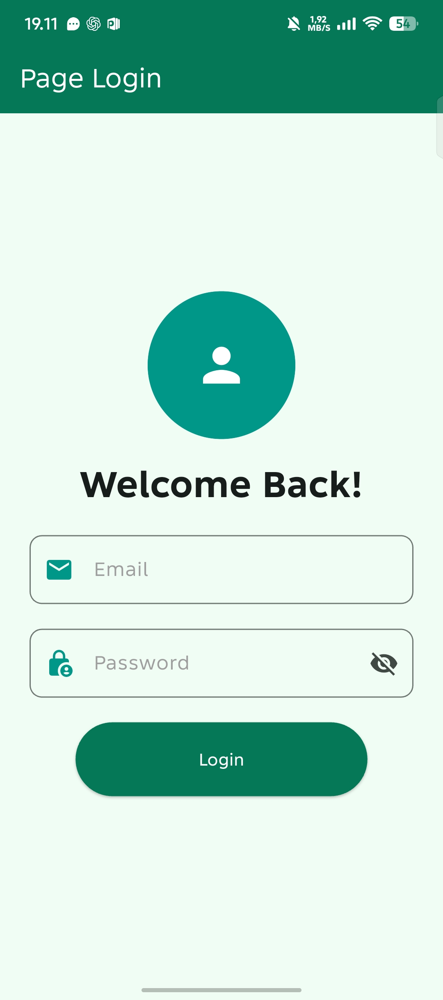
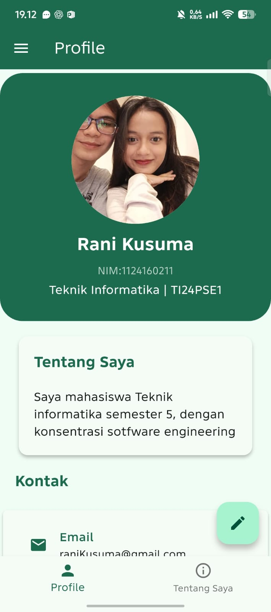
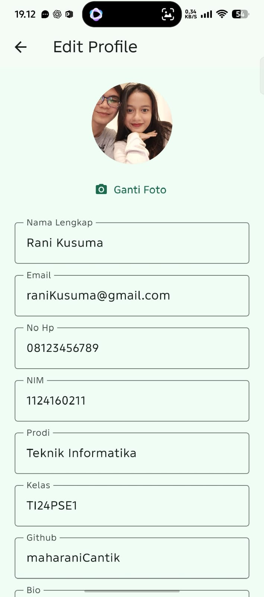
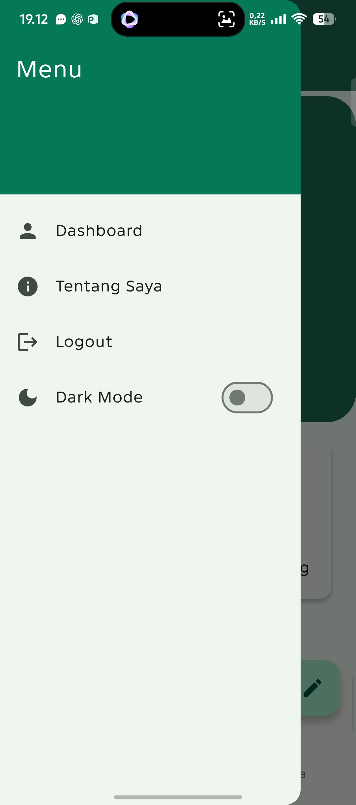
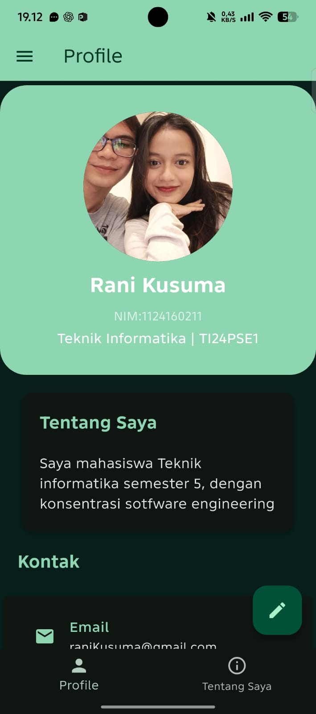

# UTS Pemrograman Mobile Lanjut (Flutter)

## Identitas Mahasiswa

- **Nama Lengkap:** Maharani Kusuma Dewi
- **NIM:** 1124160211
- **Kelas:** TI24PSE1
- **Program Studi:** S1 Teknik Informatika (Software Engineering)
- **Perguruan Tinggi:** Institut Teknologi dan Bisnis Bina Sarana Global (Global Institute)

---

## Link Penting (Video YouTube & Release APK)

- **Video Presentasi YouTube:** https://youtu.be/nYviUzvScHo?si=5tDWhX4K1Nk4i0CO
- **Download APK (v1.0.0):** https://github.com/MaharaniCantik/uts-pml-1124160211/releases/tag/v1.0.0

---

## Struktur Repositori

1. **soal1_live_coding/**: Project pengerjaan soal pertama UTS Pemrograman Mobile.
2. **soal2_profile_app/**: Project aplikasi profil mahasiswa berbasis Flutter dengan fitur pengelolaan profil, navigasi, dan tema aplikasi.

---

## Daftar Fitur Utama (soal2_profile_app)

1. **Halaman Login (LoginPage)**
   - Validasi email dan password menggunakan Form dan GlobalKey.
   - Fitur lihat dan sembunyikan password.
   - Indikator loading menggunakan CircularProgressIndicator.
   - Navigasi ke halaman profil menggunakan Navigator.pushReplacement.

2. **Halaman Profil Utama (ProfilePage)**
   - Menampilkan informasi identitas dan biodata pengguna.
   - Menampilkan foto profil dari assets.
   - Menampilkan informasi kontak.
   - Drawer Navigation.
   - Bottom Navigation Bar.
   - Floating Action Button untuk mengedit profil.

3. **Halaman Edit Profil (EditProfilePage)**
   - Mengedit informasi profil pengguna.
   - Menggunakan TextEditingController.
   - Validasi input formulir.
   - Mengirimkan data profil terbaru menggunakan Navigator.pop().
   - Memperbarui tampilan menggunakan setState().

4. **Fitur Ganti Foto Profil**
   - Memilih foto dari galeri perangkat menggunakan image_picker.
   - Menampilkan foto yang dipilih pada halaman profil.

5. **Halaman Tentang Saya**
   - Menampilkan informasi keahlian.
   - Menampilkan hobi.
   - Menampilkan riwayat pendidikan.

6. **Tema Terang dan Gelap (Light Mode / Dark Mode)**
   - Menggunakan ThemeData dan ColorScheme.
   - Pengguna dapat mengganti tema melalui Drawer.

7. **Identitas Aplikasi Android**
   - Nama aplikasi dikonfigurasi menjadi **Profil Rival** melalui atribut android:label pada AndroidManifest.xml.

---

## Screenshot Aplikasi (soal2_profile_app)

### 1. Halaman Login



### 2. Halaman Profil Utama – Light Mode



### 3. Halaman Edit Profil



### 4. Menu Navigasi



### 5. Halaman Profil – Dark Mode



---

## Cara Menjalankan Proyek

1. Clone repositori:

   ```bash
   git clone https://github.com/MaharaniCantik/uts-pml-1124160211.git
   ```

2. Masuk ke direktori project:

   ```bash
   cd uts-pml-1124160211/soal2_profile_app
   ```

3. Install dependencies:

   ```bash
   flutter pub get
   ```

4. Jalankan aplikasi:

   ```bash
   flutter run
   ```

5. Untuk membuat APK Release:

   ```bash
   flutter build apk --release
   ```

---

**Dibuat untuk memenuhi tugas Ujian Tengah Semester (UTS) Pemrograman Mobile.**
